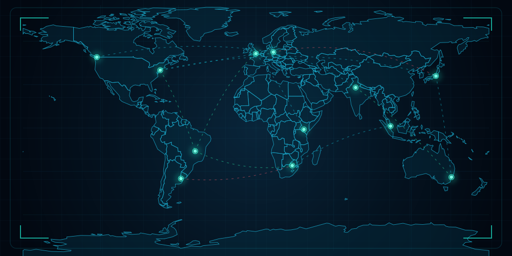

  

---

### 💻 `root@rodrigo:~$ whoami`

# Olá, eu sou Rodrigo! 👋

**Estudante de TI | Redes de Computadores | Cibersegurança**

Sou estudante de Tecnologia da Informação, construindo minha base em redes de computadores, sistemas operacionais, programação e segurança da informação.

Atualmente, estou aprofundando meus conhecimentos em **Linux, Python, redes e fundamentos de cibersegurança**, aplicando o que aprendo em laboratórios práticos e projetos pessoais.

Meu objetivo é conquistar minha primeira oportunidade profissional em TI e desenvolver minha carreira na área de **cibersegurança**, explorando tanto a segurança ofensiva quanto a defensiva.

`[ LEARNING • BUILDING • SECURING ]`

---

<h2>🛠️ root@rodrigo:~$ ls /tools</h2>

<h3>💻 Programação & Versionamento</h3>

  

<h3>🐧 Sistemas Operacionais</h3>

  

<h3>🌐 Redes & Segurança</h3>

  
  
  

<i>Ferramentas que utilizo em meus estudos e laboratórios práticos.</i>

---

<h2>📂 root@rodrigo:~$ ls /projects</h2>

  Laboratórios e projetos desenvolvidos durante
  minha jornada de aprendizado em TI e Cibersegurança.

<h3>🌐 01 // Network Infrastructure Lab</h3>

**Status:** Prática realizada — documentação em preparação

Laboratório de redes utilizando Cisco Packet Tracer,
com configuração de endereçamento IP, gateway,
dispositivos de rede e testes de conectividade.

**Tecnologias:** Cisco Packet Tracer, TCP/IP, ICMP.

---

<h3>🔎 02 // Network Traffic Analysis</h3>

**Status:** Em estudo

Práticas de captura e análise de tráfego de rede
utilizando Wireshark, explorando filtros,
pacotes e protocolos de comunicação.

**Tecnologias:** Wireshark, TCP/IP.

---

<h3>🛡️ 03 // Python File Security Analyzer</h3>

**Status:** Planejado

Projeto de ferramenta defensiva em Python para
analisar arquivos de diretórios autorizados,
calcular hashes SHA-256 e sinalizar
indicadores potencialmente suspeitos.

**Tecnologias:** Python, hashlib, pathlib.

---

  <i>Learning by doing • Building through practice</i>

<h2>📡 root@rodrigo:~$ ./connect.sh</h2>

  Estou aberto a networking, colaboração e
  oportunidades na área de tecnologia.

  

  

  

  <code>[ CONNECTION READY ]</code>

---
